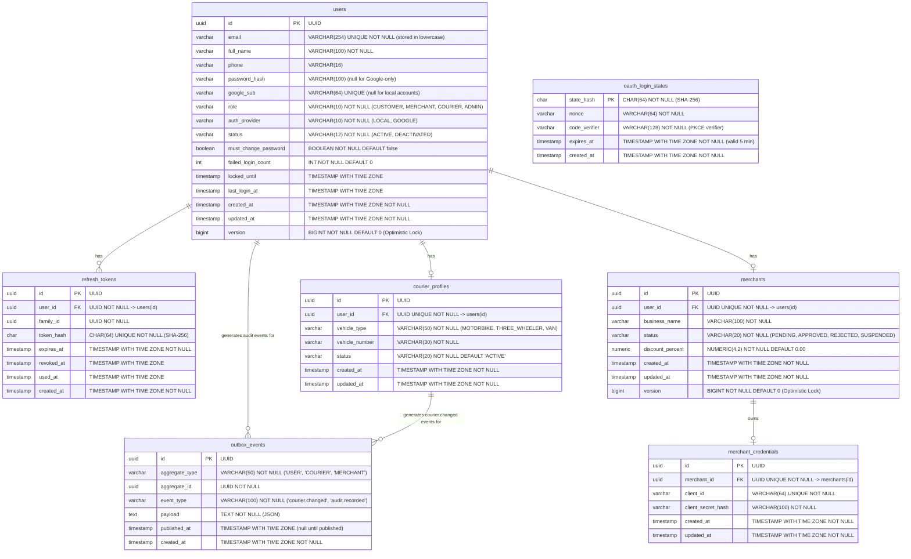

# Authentication & Identity Database Entity-Relationship Diagram

This document presents the entity-relationship model of the SwiftDrop authentication database schema per **SRS v2.1 Section 6.3 & 6.4** and **`MEMBER_02.md`**.

---

## Cardinalities & Relational Rules (SRS Section 6.4)

1. **User to Refresh Tokens (`1 : N`)**:
   - A single user may possess multiple refresh tokens across multiple login sessions / devices.
   - When reuse is detected or password is changed/reset, all tokens in the family (or all tokens for the user) are revoked simultaneously.
2. **User to Courier Profile (`1 : 0..1`)**:
   - Users with role `COURIER` possess exactly one operational profile containing vehicle details and dispatch status.
   - Non-courier accounts have no associated courier profile record.
3. **User to Merchant (`1 : 0..1`)**:
   - Users with role `MERCHANT` possess exactly one merchant record capturing business name, approval status, and negotiated discount rate.
4. **Merchant to Merchant Credentials (`1 : 0..1`)**:
   - Approved merchants may be issued a single set of API client credentials (`client_id`, `client_secret_hash`) for B2B system integration.
5. **Transient OAuth States**:
   - `oauth_login_states` records have no foreign keys to `users` because they are generated before authentication completes.
   - States are purged immediately upon use or automatically 5 minutes after creation.
