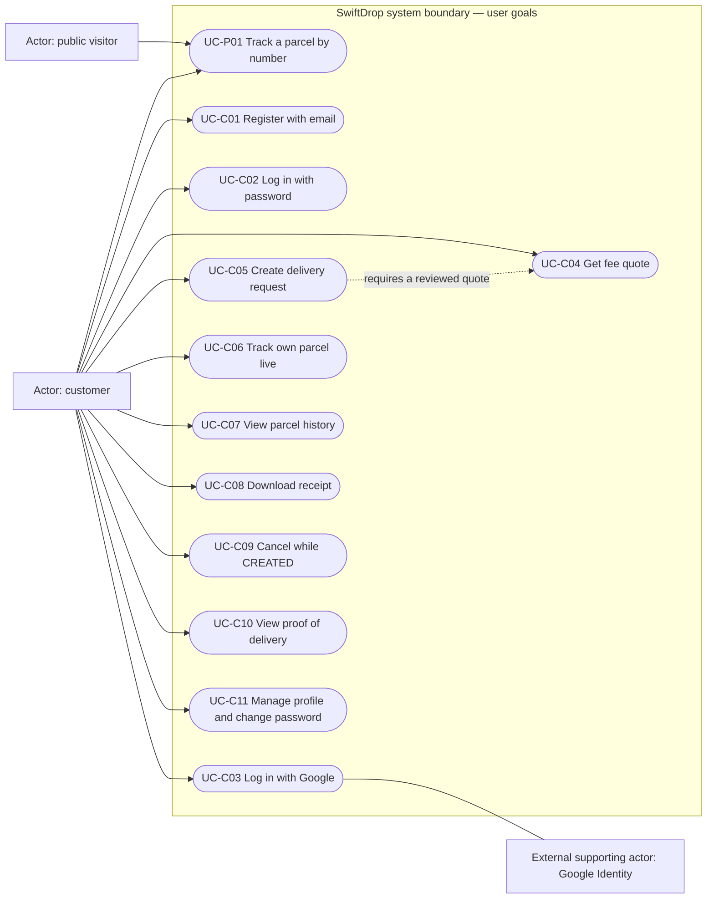

# Customer and public use cases

SRS §4.1, §7.1, §7.6 and Member #4 Prompt 3. Mermaid flowchart notation represents the use-case boundary; labelled external actors are not internal services. Customer registration/login/profile implementations belong to their respective frontend owners, not Member #4.

Customer means the person pursuing the customer role, including before registration/login. Parcel creation, history, owner timeline, receipt, cancellation and proof require an authenticated CUSTOMER session. The API enforces ownership; UI visibility does not authorize access.

| Use case | User action and normal system outcome | Alternative/error flows |
|---|---|---|
| UC-C01 | Submit account details; system registers a customer. | Existing email, invalid phone or weak password: field errors and retained input. |
| UC-C02 | Submit email/password; system establishes the session and opens the role home. | Incorrect credentials, lockout, deactivated account or forced password change. Refresh failure requires login. |
| UC-C03 | Choose Google login, complete consent; system completes the OAuth flow. | Consent denied, invalid/expired state, or email already registered locally. |
| UC-C04 | Choose districts, weight and size; system returns the authoritative fee. | Dynamic weight/format errors, unknown district/size, ZONE_NOT_SERVICEABLE, PRICING_NOT_CONFIGURED or pricing unavailable. |
| UC-C05 | Complete Details → Quote → Confirm; system creates a parcel and opens its details. | Invalid fields retain input; duplicate clicks are blocked; same body/key replays original success; changed-body key reuse is rejected. FEE_CHANGED requires a new review/key. An uncertain response is retried with the same body/key. |
| UC-C06 | Open own detail page; system composes parcel data, authenticated timeline and live tracking. | Foreign/unknown parcel returns 404; temporary projection 404 retries for up to 30 seconds; SSE failure uses the owner's polling fallback; every event/poll result refreshes composed data. Missing owner frontend contracts currently leave manual detail refresh available. |
| UC-C07 | Search/filter/sort/page own parcel history; system returns the selected page. | Empty results, reversed date range, unavailable API, expired session or forbidden role. Dates are inclusive Asia/Colombo dates. |
| UC-C08 | Select receipt download; system retrieves an authorized PDF blob. | Unknown/foreign parcel returns 404; disallowed role returns 403; download errors can be retried. Never put a bearer token in a URL. Receipt frontend integration is currently missing. |
| UC-C09 | Enter an optional reason and confirm cancellation of a CREATED parcel. | Reason over 300 characters is invalid; another owner gets 404. A concurrent status change returns INVALID_STATUS_TRANSITION; UI refreshes server state. Uncertain mutation responses also trigger a re-read. |
| UC-C10 | View a delivered parcel; system shows proof metadata and an authenticated photo blob when available. | Proof not yet available, photo download failure, or forbidden/foreign request. Proof is displayed only for DELIVERED; object URLs are revoked on refresh/unmount. |
| UC-C11 | Edit profile or change password; system validates and saves the authorized change. | Validation errors retain input; incorrect current password; forced password change gate or expired session. |
| UC-P01 | Enter a tracking number; system shows the limited public status/history view. | Malformed and unknown numbers show the same generic not-found message. Never expose contacts, addresses, fees, proof or staff notes. SSE/polling failures are handled by public tracking. |

This is the required system behavior, not a claim of live-service acceptance. Member #4 currently implements customer pages; shared auth, public tracking, receipts and live timeline remain owner integrations where indicated.
