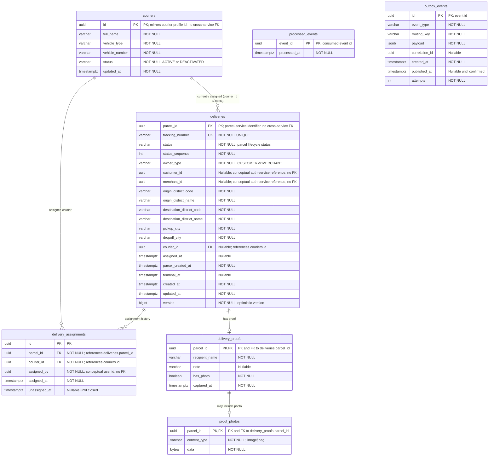

# Delivery Service Entity-Relationship Diagram

The schema below is derived from delivery-service `V1__init.sql` and the JPA entities. Solid relationships are enforced by database foreign keys. UUID references explicitly marked as conceptual have no foreign key in this database.

## Relationship and constraint notes

- `deliveries.courier_id` has a real foreign key to `couriers.id`; it is nullable to represent an unassigned delivery. Each delivery points to at most one current courier, and a courier can have zero or many currently assigned deliveries.
- `delivery_assignments.parcel_id` and `courier_id` have real foreign keys. A delivery can have multiple historical assignment rows, and a courier can appear in multiple assignments. `assigned_by` is a UUID without a foreign key.
- `delivery_proofs.parcel_id` is both its primary key and a foreign key to `deliveries.parcel_id`, so each proof belongs to exactly one delivery and each delivery has at most one proof.
- `proof_photos.parcel_id` is both its primary key and a foreign key to `delivery_proofs.parcel_id`. A proof has zero or one photo row; each photo belongs to exactly one proof.
- `processed_events.event_id` and `outbox_events.id` are standalone primary keys. Their event, aggregate, and correlation identifiers do not reference rows through database foreign keys.
- `deliveries.parcel_id` identifies a parcel owned by parcel-service, and `customer_id`, `merchant_id`, `couriers.id`, and `delivery_assignments.assigned_by` refer conceptually to identities managed by other services. Those cross-service references are not database foreign keys.
