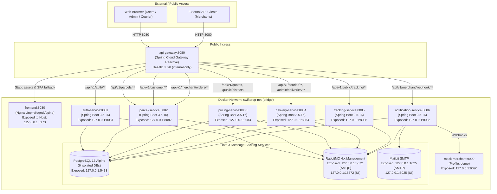
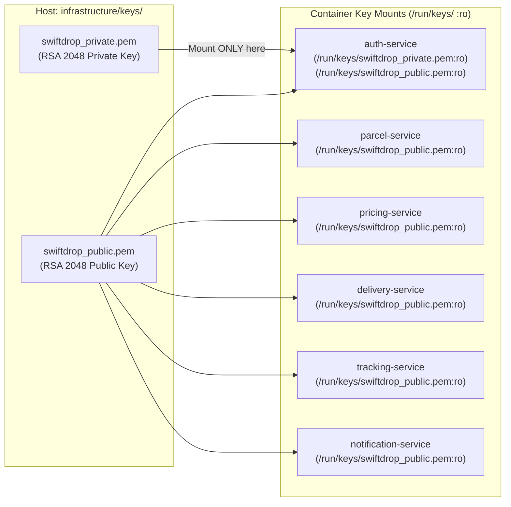
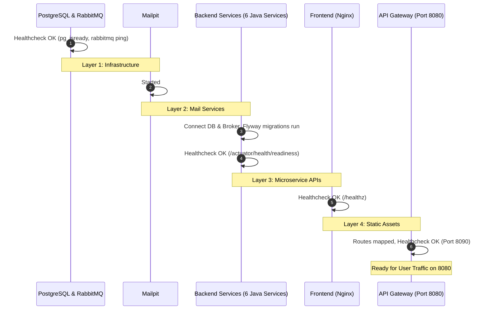

# SwiftDrop Deployment Architecture

This document describes the multi-container Docker Compose deployment architecture for SwiftDrop (SRS Section 3.1, 9.1, DEP-001..016).

---

## 1. Container Topology & Network Overview

All services run within a single bridge network (`swiftdrop-net`). Only `api-gateway` publishes port `8080` externally to public clients and end users. All internal backend and infrastructure ports are strictly bound to `127.0.0.1` for security and local inspection (DEP-007).

---

## 2. Key Mounts and Security Boundaries (DEP-013)

Cryptographic keys (RS256 JWT) are generated before starting the stack and mounted read-only into containers at `/run/keys/`:
- **Private Key (`swiftdrop_private.pem`)**: Mounted **EXCLUSIVELY** into `auth-service`. No other container or service has access to the private signing key.
- **Public Key (`swiftdrop_public.pem`)**: Mounted read-only into all resource servers (`auth-service`, `parcel-service`, `pricing-service`, `delivery-service`, `tracking-service`, `notification-service`) for JWT signature verification.

---

## 3. Persistent Volumes (DEP-006, NFR-REL-005)

Two named Docker volumes manage persistent state across container lifecycles:
1. `pgdata`: Backs `/var/lib/postgresql/data` for PostgreSQL 16. Holds the six isolated databases:
   - `swiftdrop_auth`
   - `swiftdrop_parcel`
   - `swiftdrop_pricing`
   - `swiftdrop_delivery`
   - `swiftdrop_tracking`
   - `swiftdrop_notification`
2. `rabbitmqdata`: Backs `/var/lib/rabbitmq` for RabbitMQ 4.x broker state, queues, and message storage.

Restarting containers with `docker compose down` and `docker compose up -d` preserves all database and queue state. Full reset requires `docker compose down -v`.

---

## 4. Startup Order & Healthchecks (DEP-005)

Healthchecks use lightweight readiness probes (database connectivity for Spring services via `wget` to `/actuator/health/readiness`, and management port `8090` for `api-gateway`):

