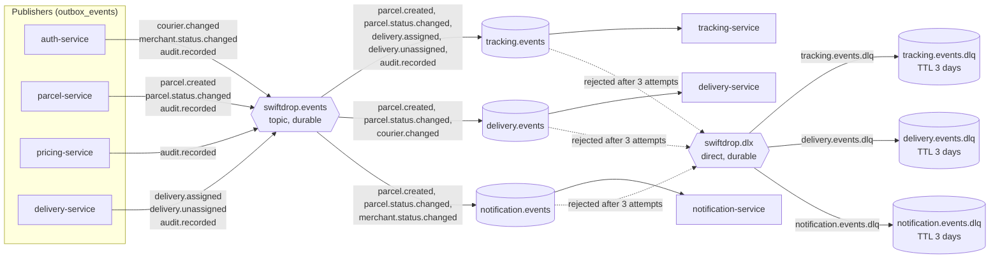
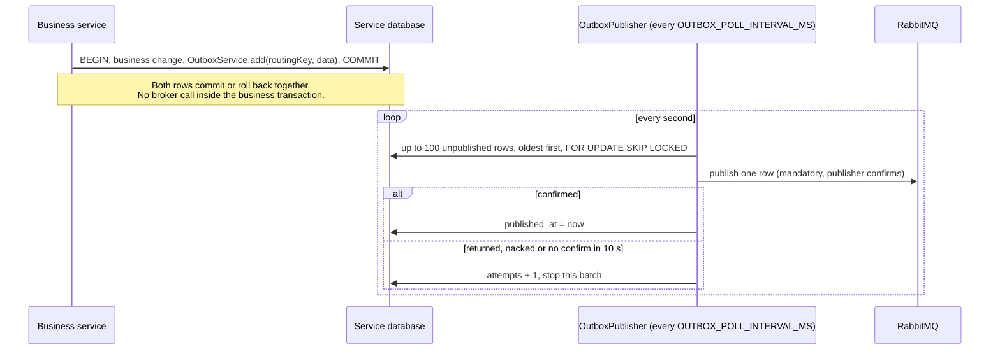
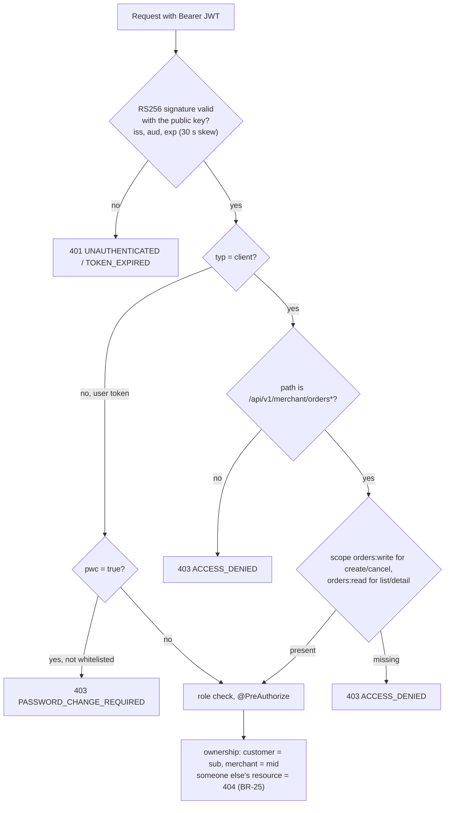

# Integration and event design (SRS 3.4 to 3.6)

Owner: Member #6. How the SwiftDrop services share code, exchange events and authenticate each other. The
developer guide with code examples is `backend/common-lib/EVENTS.md`.

## 1. Shared libraries (SRS 3.4)

| Module | Used by | Contents |
|---|---|---|
| `common-core` (pure Java) | every Java service, including api-gateway | `ErrorCode`, `DomainException`, SRS 6.2 enums, `MaskingUtil`, `Pagination`, `TrackingNumberFormat`, `PhoneNumberNormalizer` |
| `common-lib` (servlet) | the six business services, not the gateway | JWT verification, `CurrentUser`, client-token rule, `InternalKeyFilter`, `RequestIdFilter`, `GlobalExceptionHandler` (RFC 9457), `InternalRestClientFactory`, JSON logging; events: `EventEnvelope`, `EventTypes`, `EventTopology`, `OutboxService`, `OutboxPublisher`, `AuditEvents`, `EventConsumerSupport`, `ProcessedEvents` |

api-gateway is reactive and never depends on `common-lib` (Spring Cloud Gateway refuses Spring MVC on its classpath);
it has its own request-id filter and error handler.

## 2. Broker topology (SRS 3.5)



`EventTopology` declares all of this in every publisher and consumer, on every (re)connection, so services start in
any order and nobody declares a queue with different arguments. A broker that is down never stops a service from
starting.

## 3. Event envelope

```json
{
  "eventId": "uuid (= outbox row id = AMQP messageId)",
  "eventType": "parcel.status.changed (= routing key)",
  "schemaVersion": 1,
  "occurredAt": "2026-10-20T08:15:30.123Z",
  "correlationId": "uuid (X-Request-Id of the originating request)",
  "data": { "...": "the data record of the event type, SRS 3.5" }
}
```

AMQP properties: `contentType=application/json`, `deliveryMode=2` (persistent), `messageId=eventId`, `correlationId`,
`type=eventType`. Events carry no customer, merchant or recipient contact data; the staff note travels only in
`parcel.status.changed` (BR-28).

## 4. Publishing: transactional outbox (D-05)



- If RabbitMQ is down, business operations still succeed and events wait in `outbox_events` (NFR-REL-001).
- `SKIP LOCKED` means two publisher threads never send the same row.
- Published rows older than one day are deleted daily (S); a backlog gauge is exported when Micrometer is present (S).
- Services without an `outbox_events` table (tracking, notification) leave the publisher idle.
- `AuditEvents.record(...)` writes `audit.recorded` the same way and rejects detail keys such as `password`, `token`,
  `email`, `phone`, `address` or `fullName`.

## 5. Consuming: at-least-once with de-duplication

| Rule | How |
|---|---|
| Manual acknowledgement, prefetch 10 | applied to every `@RabbitListener` by `common-lib` |
| 3 attempts, waits of 1 s then 5 s | `EventConsumerSupport.handle(message, channel, handler)` |
| Then dead-letter | reject without requeue into `<queue>.dlq` (kept 3 days) |
| Unreadable message | straight to the DLQ, handler not called |
| "Not ready yet" (unknown parcel) | throw `RetryableEventException`; ordering gaps resolve through the retries |
| Duplicates | delivery and tracking: `ProcessedEvents.firstTime(eventId)` in the handler's transaction; notification: unique keys of FR-NTF-004 and FR-WHK-006 |
| Stale events | each service ignores a `sequence` not greater than the one it stored |
| Correlation | `correlationId` is put in the MDC as `requestId` while handling |

## 6. Synchronous calls (SRS 3.3, 7.4)

Only these internal calls exist; everything else is event-driven. They use `X-Internal-Key` (constant-time compare),
propagate `X-Request-Id`, time out after 5 s (connect) and 10 s (read), return callee business errors unchanged and
turn connection failures, timeouts and 5xx into 503 `SERVICE_UNAVAILABLE`. `/internal/**` is never routed through the
gateway.

| Caller | Callee | Endpoint |
|---|---|---|
| parcel | pricing | `POST /internal/v1/pricing/calculate` |
| parcel | auth | `GET /internal/v1/merchants/{merchantId}` (merchant order create and cancel) |
| delivery | parcel | `GET /internal/v1/parcels/{id}`, `POST /internal/v1/parcels/{id}/transition` |
| auth | delivery | `GET /internal/v1/couriers/{id}/active-count` |
| notification | auth, parcel | `GET /internal/v1/users/{id}/contact`, `GET /internal/v1/merchants/{id}`, `GET /internal/v1/parcels/{id}/recipient` |

## 7. Tokens and the client-token rule (SRS 3.6)



- Only auth-service holds the private key and signs tokens (RS256, `kid=swiftdrop-1`); every other service verifies
  with the public key. The gateway does not validate tokens.
- Access tokens last 15 minutes. Claims: `sub` (always a user id), `role`, `typ`, `mid` (merchants), `scope` (client
  tokens), `pwc`, `iss=swiftdrop`, `aud=swiftdrop-api`, `iat`, `exp`, `jti`. No email, phone or name.
- The client-token rule is implemented once in `common-lib`, not in each service.
