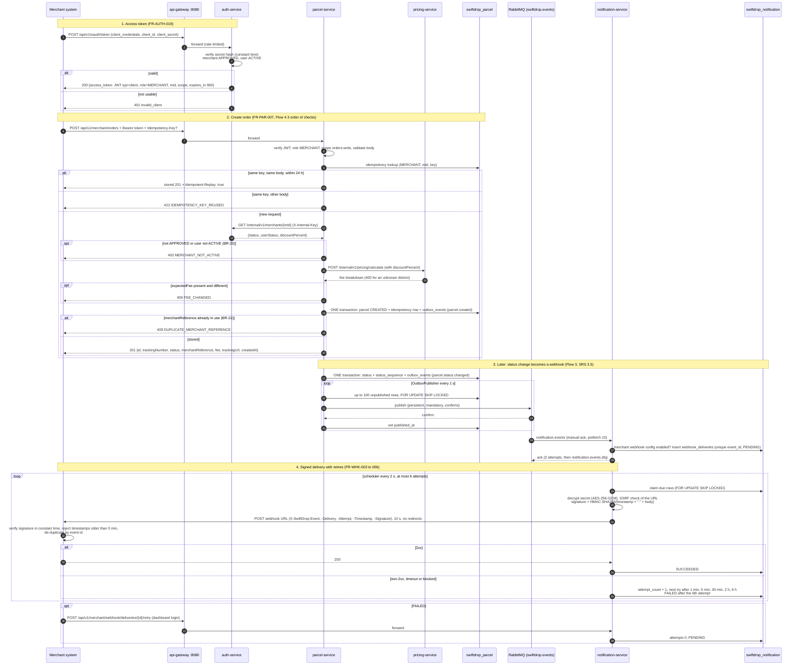

# Merchant order and webhook sequence (Flow 4.3)

Owner: Member #6. Source: SRS v2.1 Flow 4.3, FR-AUTH-019, FR-PAR-006/007, FR-WHK-002 to 006, SRS 3.5.

A merchant's own system gets a client-credentials token, creates an order, and later receives a signed webhook when
the parcel's status changes. The webhook part is shown in more detail in `webhook-sequence.md` (Member #10).

## Notes

- Client tokens (`typ=client`) are accepted only on `/api/v1/merchant/orders*` (SRS 3.6); the dashboard, receipts,
  timelines and webhook settings need a dashboard login.
- The merchant is re-checked in auth-service on every create and cancel, because an access token stays valid for up
  to 15 minutes after a suspension (BR-23, D-11).
- Events and webhook payloads carry no customer, merchant or recipient contact data (BR-28).
- `tools/postman/merchant-demo.sh` runs steps 1 and 2 against the running stack (DEP-015).
