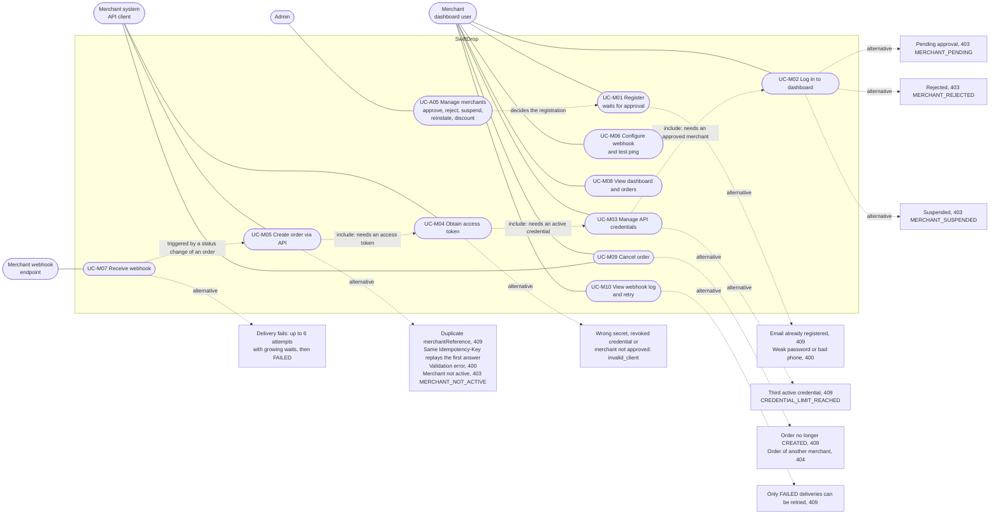
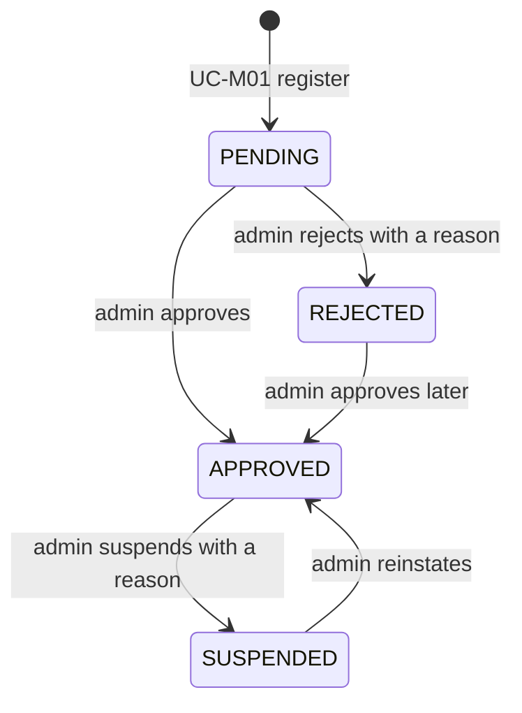

# SwiftDrop Merchant Use Cases (UC-M01 to UC-M10)

This document shows the use cases of the **merchant actor** from **SRS v2.1, section 4.1**, including the alternative flows
(pending, rejected and suspended merchants, the credential limit, duplicate order references and failed webhooks). It is
the design note for Member 3's slice: merchant registration, API credentials and merchant administration.

Mermaid has no native use-case diagram, so the picture below is a flowchart in use-case style: stadium shapes are use
cases, the actors are outside the system boundary, dashed arrows lead to alternative flows.

## Use-case diagram

## Merchant lifecycle behind UC-M01 and UC-M02 (BR-12)

The merchant can only log in, get API tokens and create orders while the status is `APPROVED` and the user is `ACTIVE`.
Suspending a merchant revokes its refresh tokens at once (BR-23). Parcels that already exist continue their delivery.

| Status | Login (UC-M02) | API token (UC-M04) | Create or cancel orders (UC-M05, UC-M09) |
|---|---|---|---|
| PENDING | 403 `MERCHANT_PENDING` | `invalid_client` | refused |
| APPROVED | allowed | allowed | allowed |
| REJECTED | 403 `MERCHANT_REJECTED` | `invalid_client` | refused |
| SUSPENDED | 403 `MERCHANT_SUSPENDED` | `invalid_client` | refused (`MERCHANT_NOT_ACTIVE`) |

## Use cases, requirements and screens

| ID | Use case | Requirements | Screen or endpoint | Alternative flows |
|---|---|---|---|---|
| UC-M01 | Register (waits for approval) | FR-AUTH-016, BR-12 | `/register-merchant` (`pages/merchant/register`), `POST /auth/register-merchant` | Email already registered (409 `EMAIL_ALREADY_REGISTERED`); validation errors (400, shown per field); success shows "waiting for admin approval" and issues no token |
| UC-M02 | Log in to dashboard | FR-AUTH-004, BR-12, BR-23 | `/login`, `POST /auth/login` | Pending, rejected and suspended merchants get 403 `MERCHANT_PENDING`, `MERCHANT_REJECTED`, `MERCHANT_SUSPENDED` (no reason in the answer); wrong credentials 401; lockout 429 |
| UC-M03 | Manage API credentials | FR-AUTH-018, FR-AUTH-023 | `/merchant/credentials` (`pages/merchant/credentials`), `POST/GET/DELETE /merchant/credentials` | At most 2 active credentials (409 `CREDENTIAL_LIMIT_REACHED`); the secret is shown once at creation; revoke needs a confirmation; another merchant's credential gives 404 |
| UC-M04 | Obtain access token (system) | FR-AUTH-019 | `POST /oauth/token` (client credentials, form-encoded) | `invalid_client` (401) for a wrong secret, revoked credential, merchant not approved or user not active; `invalid_request`, `unsupported_grant_type`, `invalid_scope` (400) |
| UC-M05 | Create order via API | FR-PAR-007, FR-PAR-006, BR-22 | `POST /merchant/orders` (API only, the dashboard has no create-order screen, D-23) | Duplicate `merchantReference` (409); idempotent replay with `Idempotency-Key`; validation (400); 403 `MERCHANT_NOT_ACTIVE`; 409 `FEE_CHANGED` when `expectedFee` differs |
| UC-M06 | Configure webhook and test ping | FR-WHK-001 | `/merchant/webhook` (Member 10) | Invalid or unsafe URL (400); the secret is shown once |
| UC-M07 | Receive webhook (system) | FR-WHK-002 to FR-WHK-008 | the merchant's own HTTPS endpoint | Signature verification by the receiver; failed attempt retried up to 6 times, then `FAILED` |
| UC-M08 | View dashboard and orders | FR-PAR-008, FR-PAR-014, FR-UI-008 | `/merchant/dashboard`, `/merchant/orders` (Member 6) | Dashboard refreshes every 30 s; another merchant's order gives 404 |
| UC-M09 | Cancel order | FR-PAR-008, BR-07 | `POST /merchant/orders/{id}/cancel` | Only while `CREATED` (otherwise 409 `INVALID_STATUS_TRANSITION`); merchant re-checked, so a suspended merchant is refused |
| UC-M10 | View webhook log and retry | FR-WHK-009 | `/merchant/webhook` delivery log (Member 10) | Only `FAILED` deliveries can be retried (409 otherwise) |

## Admin side of the merchant lifecycle (UC-A05)

| Screen | Requirements | What the admin can do |
|---|---|---|
| `/admin/merchants` and `/admin/merchants/pending` (`pages/admin/merchants`) | FR-AUTH-017 | Search by business name prefix, filter by status, page through merchants |
| `/admin/merchants/:id` | FR-AUTH-017, BR-12 | Approve (from `PENDING` or `REJECTED`), reject (from `PENDING`, reason 10 to 300 characters), suspend (from `APPROVED`, reason 10 to 300 characters), reinstate (from `SUSPENDED`), edit the discount (0 to 50 percent) |
| Admin dashboard card `PendingMerchantsCard` | FR-AUTH-024 | Shows how many merchants wait for approval and links to the pending list |

Every status action and every discount change is written to the audit log in the same transaction (FR-AUTH-023), and
every status action publishes `merchant.status.changed`, which sends the merchant an email (SRS Table 2.5).
