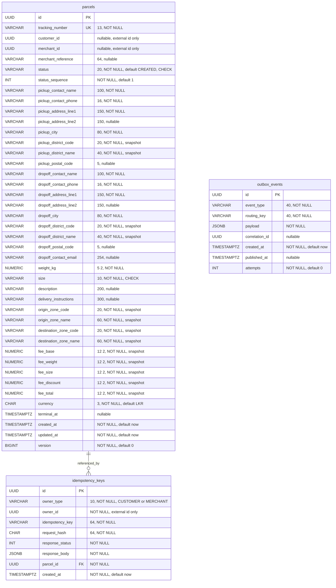

# Parcel database ER diagram

Source: `backend/parcel-service/src/main/resources/db/migration/V1__init.sql`. SRS §6.3 defines the columns and §6.4 defines service boundaries/relationships. All tables below belong to `swiftdrop_parcel`; no cross-service foreign keys are drawn.

Constraints and indexes from V1:

- `ck_parcels_exactly_one_owner`: `(customer_id IS NOT NULL) <> (merchant_id IS NOT NULL)`. These ids refer to auth-service data by value only; neither is a database FK.
- `tracking_number` is unique. Status CHECK permits CREATED, PICKED_UP, IN_TRANSIT, OUT_FOR_DELIVERY, DELIVERED, FAILED and CANCELLED. Size CHECK permits SMALL, MEDIUM and LARGE.
- `uq_parcels_merchant_reference` is a **partial composite unique index** on `(merchant_id, merchant_reference) WHERE merchant_reference IS NOT NULL AND status NOT IN ('CANCELLED','FAILED')`. Neither column is individually unique.
- Parcel indexes: `idx_parcels_customer_created(customer_id, created_at DESC)`, `idx_parcels_merchant_created(merchant_id, created_at DESC)`, `idx_parcels_status_created(status, created_at)`, and `idx_parcels_terminal_at(terminal_at)`.
- `uq_idempotency_keys_owner_key` is composite UNIQUE `(owner_type, owner_id, idempotency_key)`; no individual field is unique. `parcel_id` is a required FK to `parcels.id`, indexed by `idx_idempotency_keys_parcel_id`.
- A key row references exactly one parcel. SQL permits zero or more key rows per parcel, including zero when no key was supplied or keys expired; `parcel_id` is not unique.
- `outbox_events` has only its UUID PK and a partial `created_at` index for unpublished rows. The outbox event is written in the creation transaction, but there is **no relational FK** from outbox to parcel/key tables. Payload ids and `correlation_id` are not foreign keys.
- Numeric annotations `5 2` and `12 2` mean `NUMERIC(5,2)` and `NUMERIC(12,2)`. V1 has no weight-minimum, fee-nonnegative or maximum-weight CHECK: validation/service rules must not be presented as invented DDL constraints.
- District/zone columns and fee columns are historical snapshots, not FKs into pricing-service. Tracking, delivery, proof, auth and receipt data are not additional parcel-database tables.

FR-PAR-006 applies 24-hour replay validity and hourly key purge in application code. Atomic parcel/key/outbox writes do not imply extra ER relationships.
