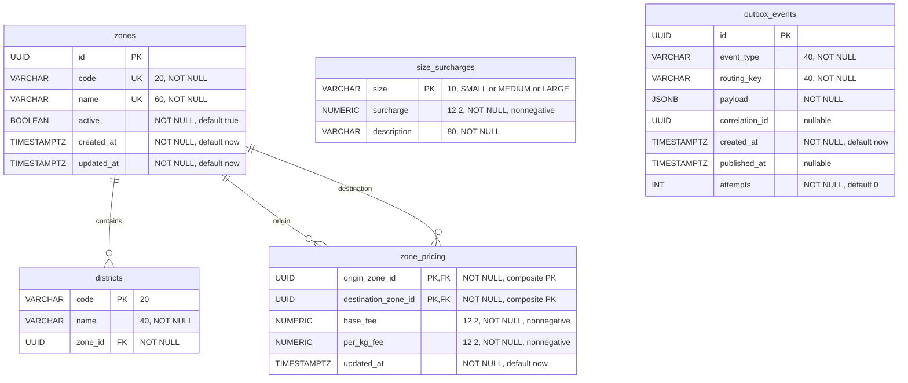

# Pricing database ER diagram

Source: `backend/pricing-service/src/main/resources/db/migration/V1__init.sql`; reference data: `V2__seed_reference_data.sql`. Corresponds to SRS §6.3 (pricing-service) and §6.4. All entities below belong to `swiftdrop_pricing`.

`zone_pricing` has one composite primary key `(origin_zone_id, destination_zone_id)`, with two independent foreign keys to `zones.id`. Pricing is directed; an origin/destination pair is not interchangeable with its reverse. The database permits zero or more districts/pricing rows per zone; seeded data supplies the required active service configuration.

Constraint/index details:

- `zones.code` and `zones.name` are separately unique and required. Code immutability is a service rule; V1 has no immutability trigger.
- `districts.zone_id` references `zones.id`, with `idx_districts_zone_id`.
- `zone_pricing.base_fee` and `per_kg_fee` are `NUMERIC(12,2)` with `CHECK >= 0`; destination has `idx_zone_pricing_destination`.
- `size_surcharges.size` is limited by CHECK to SMALL, MEDIUM, LARGE. `surcharge` is `NUMERIC(12,2)` with `CHECK >= 0`.
- `outbox_events` has a partial index on `created_at WHERE published_at IS NULL`. It has **no foreign keys**, including no FK on correlation id or JSON payload references.
- V2 seeds six zones, 25 districts, 36 directed pricing rows and three sizes. Seeding adds no tables or relationships.
- Diagram numeric annotations `12 2` mean SQL precision/scale `NUMERIC(12,2)`; lengths and nullability come from V1. No maximum-weight table/column exists: `maxWeightKg` comes from pricing-service configuration.
