# SwiftDrop Webhook Lifecycle Sequence Diagram (Flow 4.3)

This document visualizes the complete lifecycle of webhook deliveries in SwiftDrop per **SRS v2.1 (Section 4, Flow 4.3; Section 5, FR-WHK-001 through FR-WHK-010)**, the Master Prompt, and `MEMBER_10.md`.

It covers:
1. Parcel status change event publishing and asynchronous notification consumption
2. Webhook enqueuing via `WebhookEnqueueService` with BR-28 data sanitization
3. Asynchronous scheduled polling using `SELECT ... FOR UPDATE SKIP LOCKED`
4. SSRF re-validation at send time and HMAC-SHA256 request signing
5. Target dispatch via `java.net.http.HttpClient` with exponential backoff retries
6. Manual merchant retry for terminal `FAILED` deliveries

```mermaid
sequenceDiagram
    autonumber
    actor Courier as Courier / Driver
    participant DeliverySvc as delivery-service
    participant Rabbit as RabbitMQ (swiftdrop.events)
    participant NtfConsumer as notification-service Consumer
    participant EnqueueSvc as WebhookEnqueueService
    participant DB as PostgreSQL (swiftdrop_notification)
    participant Scheduler as WebhookSenderScheduler
    participant ClaimSvc as WebhookClaimService
    participant SenderSvc as WebhookSenderService
    participant Ssrf as SsrfValidator
    participant Signer as HmacSigner / SecretCipher
    participant MerchantEndpoint as Merchant Webhook Receiver
    actor Merchant as Merchant Dashboard User

    %% Step 1: Event Publication
    Courier->>DeliverySvc: PATCH /api/v1/courier/deliveries/{id}/status (e.g. DELIVERED)
    DeliverySvc->>DeliverySvc: Update delivery & parcel status
    DeliverySvc->>Rabbit: Publish EventEnvelope<ParcelStatusChangedData> ("parcel.status.changed")

    %% Step 2: Consumption & Enqueuing
    Rabbit->>NtfConsumer: Deliver "parcel.status.changed" envelope
    NtfConsumer->>EnqueueSvc: enqueueStatusChanged(envelope)
    
    EnqueueSvc->>DB: SELECT * FROM merchant_webhook_config WHERE merchant_id = envelope.data.merchantId
    alt Merchant unconfigured or webhook disabled
        EnqueueSvc-->>NtfConsumer: No-op (skip enqueuing)
    else Merchant config enabled
        Note over EnqueueSvc: Build payload (FR-WHK-002, BR-28):<br/>- id = eventId<br/>- type = "parcel.status.changed"<br/>- data: trackingNumber, status, reason<br/>- EXCLUDES recipient PII & staff notes
        EnqueueSvc->>DB: INSERT INTO webhook_deliveries (event_id, merchant_id, event_type, tracking_number, payload, target_url, status='PENDING', attempt_count=0, next_attempt_at=now())
        Note over DB: Unique constraint on event_id ensures idempotency
        EnqueueSvc-->>NtfConsumer: Enqueued successfully
    end

    %% Step 3: Scheduled Dispatch Loop
    loop Every 2 Seconds (WebhookSenderScheduler)
        Scheduler->>ClaimSvc: claimDueDeliveries(batchSize = 25)
        ClaimSvc->>DB: SELECT * FROM webhook_deliveries WHERE status = 'PENDING' AND next_attempt_at <= now() ORDER BY next_attempt_at ASC LIMIT 25 FOR UPDATE SKIP LOCKED
        Note over ClaimSvc: Extend lease:<br/>UPDATE next_attempt_at = now() + 30s
        ClaimSvc-->>Scheduler: Return claimed delivery batch
        
        loop For each claimed delivery (outside transaction)
            Scheduler->>SenderSvc: dispatchDelivery(delivery)
            
            SenderSvc->>DB: SELECT * FROM merchant_webhook_config WHERE merchant_id = delivery.merchantId
            
            %% Step 4: SSRF & Crypto
            SenderSvc->>Ssrf: validateUrl(config.url)
            alt SSRF Check Fails (private IP, metadata 169.254.169.254, loopback)
                Ssrf-->>SenderSvc: Reject URL
                SenderSvc->>DB: Record attempt failure (last_error: "SSRF validation failed", schedule retry)
            else URL is Safe
                SenderSvc->>Signer: Decrypt secret (AES-256-GCM) & compute HMAC-SHA256 signature
                Note over Signer: Signature = sha256=HMAC(secret, timestamp + "." + rawBody)
                
                %% Step 5: HTTP Dispatch
                SenderSvc->>MerchantEndpoint: POST config.url<br/>X-SwiftDrop-Event: parcel.status.changed<br/>X-SwiftDrop-Delivery: <eventId><br/>X-SwiftDrop-Attempt: 1<br/>X-SwiftDrop-Timestamp: <unix_seconds><br/>X-SwiftDrop-Signature: sha256=<hex><br/>Body: <raw_json_bytes>
                
                alt HTTP 2xx within 10s timeout
                    MerchantEndpoint-->>SenderSvc: HTTP 200 OK
                    SenderSvc->>DB: UPDATE webhook_deliveries SET status='SUCCEEDED', last_http_status=200, completed_at=now(), next_attempt_at=NULL
                else Non-2xx Response, Timeout (10s), or Connection Failure
                    MerchantEndpoint-->>SenderSvc: HTTP 500 / Timeout
                    alt Attempt count < 6
                        Note over SenderSvc: Calculate exponential backoff:<br/>PT1M, PT5M, PT30M, PT2H, PT6H
                        SenderSvc->>DB: UPDATE webhook_deliveries SET status='PENDING', attempt_count=attempt_count+1, last_http_status=500, next_attempt_at=now()+backoff
                    else Attempt count == 6 (Terminal Failure)
                        SenderSvc->>DB: UPDATE webhook_deliveries SET status='FAILED', attempt_count=6, completed_at=now(), next_attempt_at=NULL
                    end
                end
            end
        end
    end

    %% Step 6: Manual Retry from Merchant Dashboard
    opt Manual Retry for FAILED Deliveries
        Merchant->>SenderSvc: POST /api/v1/merchant/webhook/deliveries/{id}/retry
        alt Delivery status is not FAILED
            SenderSvc-->>Merchant: 409 INVALID_STATUS_TRANSITION
        else Delivery is FAILED and belongs to caller's merchant
            SenderSvc->>DB: UPDATE webhook_deliveries SET status='PENDING', attempt_count=0, next_attempt_at=now(), last_error=NULL WHERE id = {id}
            SenderSvc-->>Merchant: 200 OK (Re-queued delivery)
        end
    end
```

---

## Architectural Guarantees

1. **At-Least-Once Delivery with De-duplication:**
   * Every webhook delivery is guaranteed to be attempted at least once.
   * Merchants de-duplicate incoming deliveries by inspecting the header `X-SwiftDrop-Delivery` (the unique event UUID).
2. **Zero PII Exposure (BR-28):**
   * Payloads contain only `id`, `type`, `createdAt`, `data.trackingNumber`, `data.status`, and `data.reason`.
   * Recipient names, phone numbers, addresses, and staff internal notes are strictly omitted.
3. **Lock-Free Concurrency (`FOR UPDATE SKIP LOCKED`):**
   * Multi-instance notification schedulers can poll simultaneously without blocking or double-dispatching deliveries.
4. **SSRF Guardrails:**
   * URLs are checked at both configuration time (`PUT /merchant/webhook`) and immediately before dispatch in `WebhookSenderService`.

